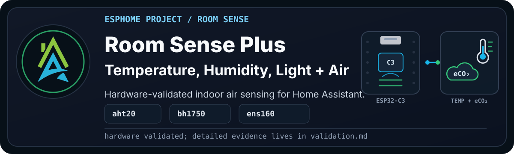

  

> [!WARNING]
> **Disclaimer:** These files are shared as-is, with the usual "it works in my
> environment" honesty baked in. They come from real builds, test devices, and
> ongoing experiments, but they are not guaranteed to work safely or correctly
> in your setup. Check the code, wiring, pins, power, secrets, calibration, and
> local rules and regulations before using anything.

`HAZA Room Sense Plus` is the next step after Room Sense Basic.

Basic tells us how the room feels through temperature, humidity, dew point, and
light. Plus adds a first indoor-air signal with the ENS160: eCO2, TVOC, and the
sensor's air quality index.

This is useful when a room feels stale, people complain about headaches, plants
are sensitive to airflow, or you want Home Assistant to have more than just
temperature and humidity before making ventilation decisions.

<b>Current Status</b>
 

- YAML recipe: [`esphome_room_sense_plus_project.yaml`](esphome_room_sense_plus_project.yaml)
- Alternate YAML recipe: `esphome_room_sense_plus_project_alternate.yaml`
- Config validation: Passed on ESPHome `2026.7.3`
- Compile validation: Passed on ESPHome `2026.7.3`
- Physical validation: ENS160 recipe passed OTA and web visual confirmation on
  a private validation device
- Verified alternate: ESP32-C6, BME280, BH1750, and SGP30 passed config,
  compile, OTA, web access, and live-value checks on a private validation device
- Documentation approval: Draft, pending Pascal review

Full validation notes live in [validation.md](documents/validation.md).

## Project Profile

| Factor | Rating | Notes |
| --- | --- | --- |
| Difficulty | Intermediate | Same I2C wiring as Basic, with one extra sensor and more values to interpret. |
| Estimated cost | Low to medium | Depends on the ENS160 module price and what parts you already have. |
| Build time | 1-2 hours | Allow extra time to confirm I2C addresses and sensor placement. |
| Tools needed | Basic plus soldering | USB cable, Dupont wires, breadboard or soldering tools, and a computer. |
| Off-the-shelf viability | Either | Buy if you want a finished air-quality device. Build if you want ESPHome packages and custom room logic. |
| Maintenance burden | Medium | Placement matters, and air-quality interpretation needs common sense. |

## Why Build This?

Temperature and humidity explain part of a room, but not all of it.

Sometimes a room is the right temperature and still feels wrong. It may need
fresh air, or it may have cleaning-product fumes, printer smells, cooking
residue, or general indoor-air buildup.

Room Sense Plus adds a VOC and eCO2 view so we can start seeing those patterns.
The main recipe uses ENS160. The alternate recipe uses SGP30 where that module
is a better fit or is what you already have on hand.

Neither version makes the device a certified air-quality monitor. It gives Home
Assistant a practical signal that can help with ventilation experiments and
future automations.

## What Problems It Solves

- Keeps the Basic temperature, humidity, dew point, and illuminance readings.
- Adds ENS160 eCO2 as a ventilation-style indicator.
- Adds ENS160 TVOC as a volatile-organic-compound indicator.
- Adds the ENS160 air quality index.
- Creates a path toward smarter fan, window, extractor, and HVAC decisions.

## What Possibilities It Creates

Once the readings are in Home Assistant, they can help answer questions like:

- Does this room get stale when the door is closed?
- Does ventilation improve the readings?
- Do certain activities create repeatable VOC spikes?
- Should a fan, extractor, or air purifier run for a while?
- Is a later particulate-sensing Room Sense Air build worth adding here?

Keep the first automations cautious. Treat ENS160 values as useful indicators,
not lab-grade proof.

## What This Project Does

The device exposes:

- AHT20 temperature
- AHT20 humidity
- AHT20 calculated dew point
- BH1750 illuminance
- BH1750 illuminance human-readable label
- ENS160 eCO2
- ENS160 TVOC
- ENS160 air quality index
- ENS160 human-readable classification labels from the shared package
- standard ESPHome diagnostic entities from the shared framework packages

## Hardware And Bill Of Materials

### Visual Reference

Add clean component photos here as they become available.

- Pending: ESP32-C3 Super Mini on a clean background.
- Pending: AHT20 temperature and humidity sensor.
- Pending: BH1750 illuminance sensor.
- Pending: ENS160 VOC/eCO2 sensor.
- Pending: assembled Room Sense Plus validation device.

| Item | Recommended Part | Image | Viable Alternatives | Notes |
| --- | --- | --- | --- | --- |
| Controller | ESP32-C3 Super Mini | To do: `assets/esp32-c3-super-mini.png` | Other ESP32-C3 boards | Pin mapping and board package may change. |
| Temperature and humidity | AHT20 module | To do: `assets/aht20-sensor.png` | SHT40, BME280 | Alternatives need matching YAML packages and may expose different entities. |
| Illuminance | BH1750 module | To do: `assets/bh1750-sensor.png` | Other ESPHome-supported lux sensors | Wiring and package will change. |
| VOC and eCO2 | ENS160 module | To do: `assets/ens160-sensor.png` | SGP30, CCS811 | Alternatives need different packages and different interpretation. |
| Wiring | Dupont leads or soldered wire | Optional build photo | JST/Grove/Qwiic if your modules support it | Keep power, ground, SDA, and SCL clear and consistent. |
| Mounting | Project box or printed enclosure | To do | Breadboard for testing | Keep sensor openings exposed to room air and representative light. |

> [!WARNING]
> Alternatives are not automatically drop-in replacements. Check the matching
> framework package, GPIO mapping, I2C address, voltage, wiring, enclosure, and
> interpretation before relying on a changed board or sensor.

## Who This Is For

Build this if Room Sense Basic is working and you want a first indoor-air
quality signal.

It is especially useful if you are:

- testing room ventilation ideas
- comparing rooms that feel different
- planning a fan, extractor, or air purifier automation
- building toward Room Sense Air or Room Sense Presence later

Skip it for now if you need certified air-quality measurements, CO2 compliance
logging, or particulate measurements. That is not what this project claims.

## Wiring

Disconnect power before changing wiring. Check the exact hardware's supply and
signal levels against the controller GPIO limits before connecting it.

> [!WARNING]
> The supplied diagram connects the sensors to the rail labelled 5 V. The
> table below specifies 3.3 V sensor power. Confirm the supply and logic
> requirements of your exact modules before following the diagram.

Use the wiring table when checking the diagram.

| Component | Pin | Connects To | Notes |
| --- | --- | --- | --- |
| AHT20 | VCC | 3V3 | Use 3.3V unless your module explicitly supports another voltage. |
| AHT20 | GND | GND | Common ground with the ESP32-C3. |
| AHT20 | SDA | GPIO9 | Shared I2C bus. |
| AHT20 | SCL | GPIO10 | Shared I2C bus. |
| BH1750 | VCC | 3V3 | Use 3.3V unless your module explicitly supports another voltage. |
| BH1750 | GND | GND | Common ground with the ESP32-C3. |
| BH1750 | SDA | GPIO9 | Shared I2C bus. |
| BH1750 | SCL | GPIO10 | Shared I2C bus. |
| ENS160 | VCC | 3V3 | Use 3.3V unless your module explicitly supports another voltage. |
| ENS160 | GND | GND | Common ground with the ESP32-C3. |
| ENS160 | SDA | GPIO9 | Shared I2C bus. |
| ENS160 | SCL | GPIO10 | Shared I2C bus. |

For the SGP30 alternate, use the same shared I2C idea, but follow the board
package used by that YAML. The verified alternate uses the ESP32-C6 Super Mini,
BME280, BH1750, and SGP30 on C6 I2C SDA `GPIO14` and SCL `GPIO18`.

Expected I2C addresses:

- BH1750: `0x23`
- AHT20: `0x38`
- ENS160: `0x53`
- SGP30 alternate: `0x58`

## Setup

1. Open the [main recipe](esphome_room_sense_plus_project.yaml) or the
   [SGP30 alternate](esphome_room_sense_plus_project_alternate.yaml) in this folder.
   Keep its relative package layout intact; adapt includes if you copy the YAML.
2. Review device substitutions, the selected board and sensor addresses.
3. Provide the required secret bindings in your device's own `secrets.yaml`.
4. Validate the configuration, then compile.
5. For a new or repurposed board, follow the erase-first guidance in
   [First Firmware Upload](https://github.com/homeautomatorza/ESPHome-Modules/wiki/first-firmware-upload).
6. Upload, then confirm the expected I2C sensors in the logs and web server.
7. Add or review the device in Home Assistant and compare its readings with the room state.

If you are replacing an existing ESPHome device, match any existing OTA password
for the first migration upload. To move to encrypted OTA using the API key,
first install firmware built with ESPHome `2026.9.0` or newer while retaining
that password, then enable OTA `encryption:` and remove the password for the
next upload. See [OTA troubleshooting](documents/troubleshooting.md#ota-upload-asks-for-a-password)
for the migration and recovery options.

<b>Framework Packages Used</b>
 

- Board: `boards/esp32/c3_super_mini.yaml`
- Core: `common/core/settings.yaml`
- Time: `common/time/home_assistant.yaml`
- Network helpers: `common/network/wifi.yaml`
- Public recipe network: `common/network/wifi_dynamicip.yaml`
- Web server: `common/network/webserver.yaml`
- Sensor: `sensors/i2c/bh1750.yaml`
- Sensor: `sensors/i2c/aht2x_3x.yaml`
- Sensor: `sensors/i2c/ens160.yaml`

The SGP30 alternate uses:

- Board: `boards/esp32/c6_super_mini.yaml`
- Sensor: `sensors/i2c/bme280.yaml`
- Sensor: `sensors/i2c/sgp30.yaml`

## Visual Checks

To add during physical validation:

- Pending: ESPHome web server view for Room Sense Plus.
- Pending: Home Assistant device page for Room Sense Plus.
- Pending: close-up of assembled board and sensors.
- Pending: device installed in the room.

## Home Assistant Entities

<b>Expected user-facing entities</b>
 

Expected user-facing entities:

- AHT20 Temperature (C)
- AHT20 Humidity
- AHT20 Dew Point
- BH1750 Illuminance
- BH1750 Illuminance Human Readable
- ENS160 eCO2
- ENS160 Total Volatile Organic Compounds
- ENS160 Air Quality Index
- ENS160 eCO2 Classification
- ENS160 TVOC Level
- ENS160 Air Quality Rating
- Uptime
- IP Address
- Connected SSID
- Wifi Signal Strength

The exact entity IDs depend on the device substitutions used for the local
deployment.

The SGP30 alternate exposes these air-quality entities instead of the ENS160
entities:

- SGP30 eCO2
- SGP30 eCO2 Classification
- SGP30 TVOC
- SGP30 TVOC Level

## Calibration And Tuning

No formal calibration is included yet.

Placement still matters:

- Keep the AHT20 exposed to room air.
- Keep the BH1750 exposed to representative room light.
- Keep the ENS160 away from heat, solvents, cleaning products, and direct
  airflow unless that is the condition you are deliberately testing.
- Let the device run for a while before judging the ENS160 readings.

## Known Limitations

- The ENS160 Plus recipe still needs its final documentation screenshots.
- The SGP30 alternate was validated on a private C6/BME280 validation device.
- ENS160 readings are practical indoor-air indicators, not certified
  measurements.
- SGP30 readings are also practical indoor-air indicators, not certified
  measurements.
- PM2.5, movement, and presence are not part of Plus.
- Component images are still being added; the wiring diagram's power supply
  needs review against the table above.

## Validation Evidence

See [validation.md](documents/validation.md).

## Troubleshooting

See [troubleshooting.md](documents/troubleshooting.md).

## Changelog

See [changelog.md](documents/changelog.md).

## Related Projects And Next Variants

Check each guide's wiring, packages and validation notes before changing your
build; these variants use different sensor and board combinations.

- [Room Sense Basic](../basic/README.md): temperature, humidity and light sensing.
- [Room Sense Air](../air/README.md): comfort, light and indoor-air sensing with SPS30 particulate measurements.
- [Room Sense Motion](../motion/README.md): comfort and light sensing with HC-SR501 PIR movement detection.
- [Room Sense Presence](../presence/README.md): comfort and light sensing with PIR movement and LD2410C mmWave presence detection.
- [Room Sense Max](../max/README.md): the combined comfort, light, indoor-air, particulate, movement and presence build.
