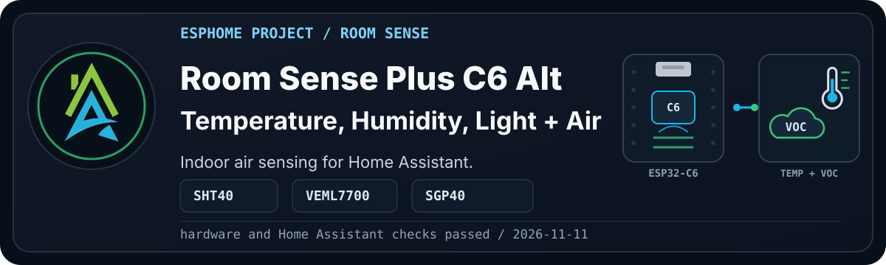
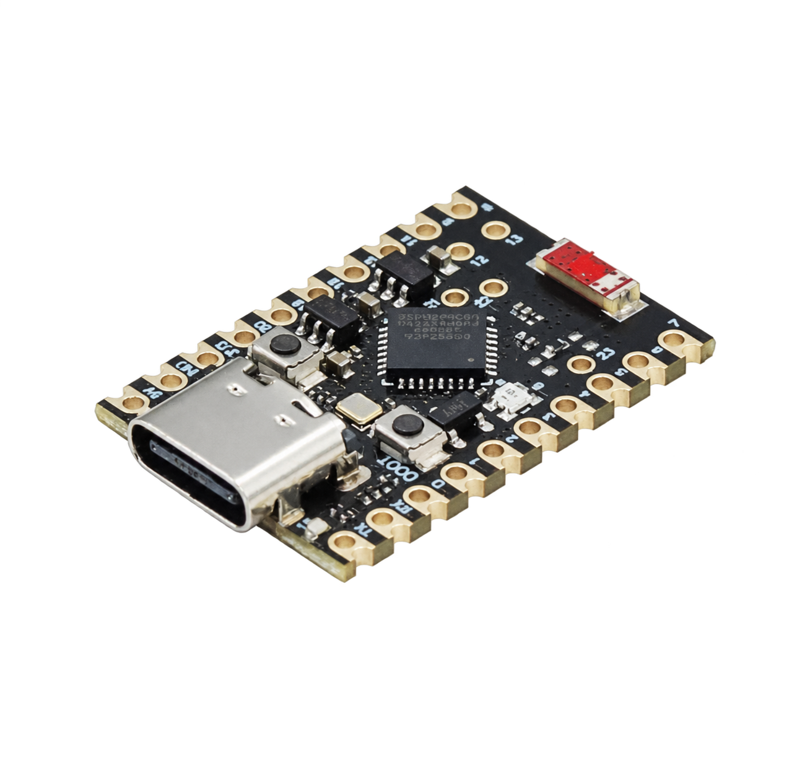
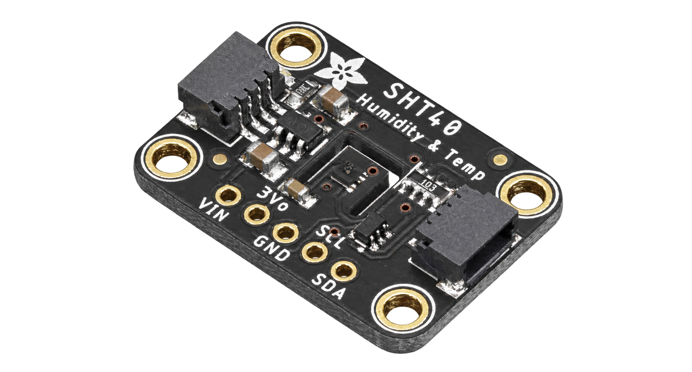
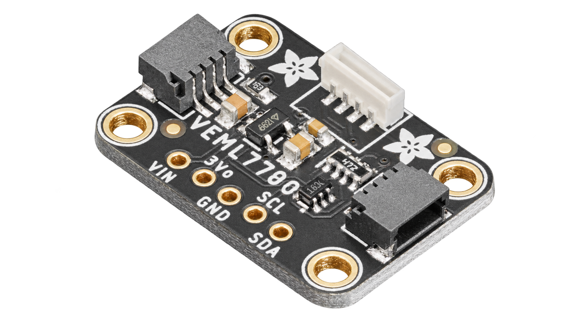
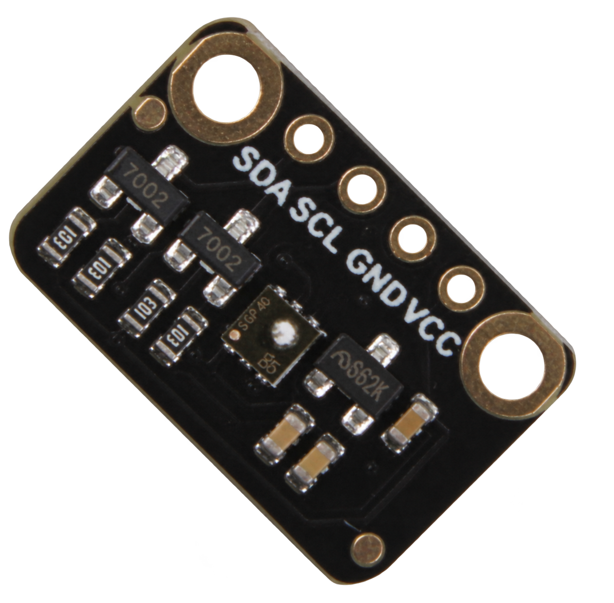
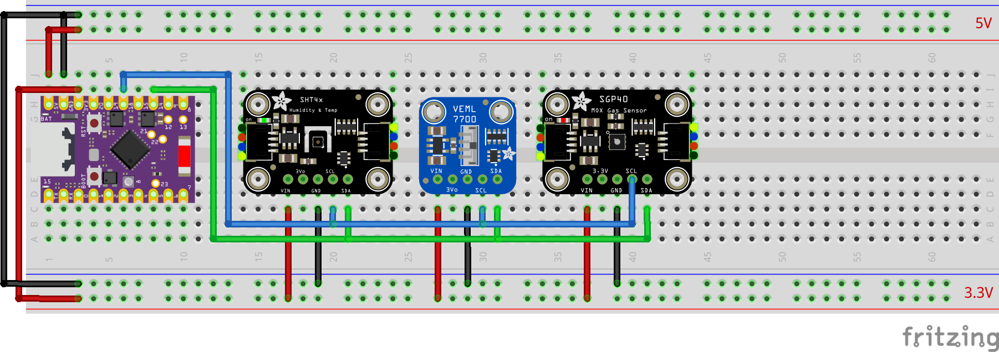
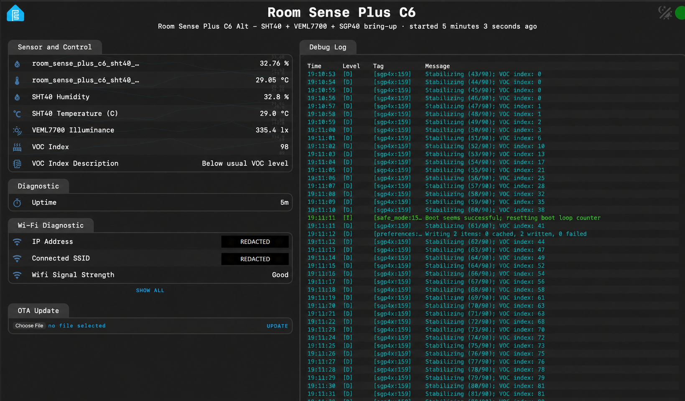
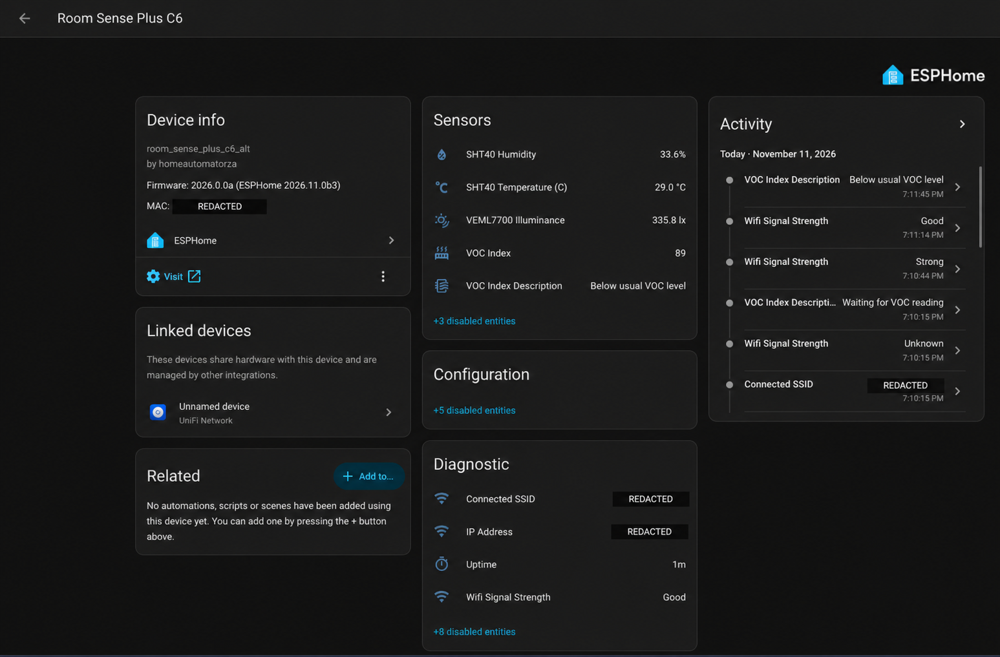

  

> [!WARNING]
> **Disclaimer:** These files are shared as-is, with the usual "it works in my
> environment" honesty baked in. They come from real builds, test devices, and
> ongoing experiments, but they are not guaranteed to work safely or correctly
> in your setup. Check the code, wiring, pins, power, secrets, calibration, and
> local rules and regulations before using anything.

Room Sense Basic tells us how the room feels through temperature, humidity,
dew point and light. Room Sense Plus C6 Alt takes the next step with an
ESP32-C6 Super Mini, SHT40, VEML7700 and an SGP40 VOC Index signal.

This is useful when you want to compare room conditions, explore changes in
VOC readings around cooking or cleaning, or give Home Assistant more than
temperature and humidity for ventilation experiments.

This is an alternate version of Room Sense Plus and a launching pad for the more
advanced models in the series. It uses different sensors from the C3/ENS160
build and has its own development and validation record.

<b>Current Status</b>
 

- YAML recipe: [Three-sensor C6 Alt build](esphome_room_sense_plus_c6_alternate.yaml).
- Hardware: ESP32-C6 Super Mini, SHT40, VEML7700 and SGP40.
- I²C: SDA GPIO14, SCL GPIO18; addresses `0x44`, `0x10` and `0x59` observed.
- Config validation: the stack and VOC description passed ESPHome `2026.10.0` on 2026-11-11.
- Running firmware: ESPHome `2026.11.0b3`, build timestamp 2026-11-11 19:09:11 +0200.
- Physical and HA checks: temperature, humidity, illuminance, VOC Index and VOC description observed.
- Visual evidence: screenshots saved privately; sanitized presentation copies linked below.
- Wiring: corrected Fritzing diagram and matching table added on 2026-11-12.
- Documentation approval: approved by Pascal on 2026-11-12.

Full validation notes live in [validation.md](documents/validation.md).
The sensor bring-up and initial Home Assistant checks are recorded. The project and documentation were approved by Pascal on 2026-11-12.

## Project Profile

These are estimates; the parts and assembly method will affect the cost and build time.

| Factor | Rating | Notes |
| --- | --- | --- |
| Difficulty | Intermediate | Shared I²C wiring, with three sensors and a VOC Index signal to interpret. |
| Estimated cost | Low to medium | Depends on the SGP40 module price and what parts you already have; no priced BOM yet. |
| Build time | 1–2 hours for initial assembly | Allow additional time for staged firmware bring-up, address checks and sensor placement. |
| Tools needed | Basic plus soldering | USB cable, DuPont wires, breadboard or soldering tools, and a computer. Final assembly method is pending. |
| Off-the-shelf viability | Either | Buy if you want a finished room sensor with suitable measurements. Build if you want ESPHome packages and custom room logic. |
| Maintenance burden | Medium | Placement matters, and interpreting VOC trends takes care. Reassess after longer use. |

## Why Build This?

Temperature and humidity explain part of a room, but not all of it.

A room can be at a comfortable temperature while cooking, cleaning products
or other indoor activities change its VOC readings. Adding a VOC Index gives
us another signal to compare with what is happening in the room.

Room Sense Plus C6 Alt explores that combination using SHT40 temperature and
humidity, VEML7700 illuminance and the SGP40 VOC Index. It keeps this build
separate from the established C3/ENS160 version.

It is not a certified air-quality monitor. The aim is to give Home Assistant
useful room-condition signals for dashboards, ventilation experiments and
future automations. These readings have been observed in the ESPHome web server and Home Assistant.

## What Problems It Solves

This build:

- Brings temperature, humidity, illuminance and VOC Index into one room sensor.
- Helps compare VOC trends with activities such as cooking or cleaning.
- Provides inputs for fan, extractor and HVAC experiments in Home Assistant.
- Gives us a starting point for more advanced room-monitoring projects.

## What Possibilities It Creates

With the readings in Home Assistant, you can explore:

- How temperature, humidity and VOC Index change during everyday activities.
- Whether opening a window or running an extractor changes those readings.
- Whether particular activities produce repeatable VOC Index changes.
- Which room-condition signals would be useful for future automations.
- Whether a later particulate-sensing Room Sense Air build would add useful information.

Start by observing trends alongside known room activities. Automation thresholds
and actions are not implemented in this project yet.

## What This Project Does

The device exposes:

- SHT40 temperature
- SHT40 humidity
- VEML7700 illuminance
- SGP40 VOC Index and its human-readable description
- standard ESPHome diagnostics from the selected board and framework packages

The entity names below match the implemented packages.
Home Assistant integration through the encrypted native API is required from
the first bring-up stage.

The SGP40 provides a VOC Index. It does not provide CO₂, eCO2, TVOC
concentration or the ENS160 air quality index. This build does not inherit
validation from another Room Sense variant.

## Hardware And Bill Of Materials

### Visual Reference

| Item | Recommended Part | Image | Viable Alternatives | Notes |
| --- | --- | --- | --- | --- |
| Controller | ESP32-C6 Super Mini |  | Other ESP32-C6 boards | Board package and pin mapping may change. |
| Temperature and humidity | SHT40 |  | AHT20 or BME280 | Address `0x44`, confirmed by the 2026-11-11 device scan. Use the matching package; wiring and available measurements may change. |
| Light | VEML7700 |  | Other ESPHome-supported lux sensors | Address `0x10`, confirmed by the device scan on 2026-11-11. Use the matching package and check the I²C address and wiring. |
| VOC | SGP40 |  | A separate ENS160 or SGP30 variant | Address `0x59`, confirmed by the device scan on 2026-11-11. Different outputs and interpretation; use the matching variant guide. |
| Wiring | DuPont leads or soldered wire | Pending | Compatible JST/Grove/Qwiic cables | Confirm connector pin order and power rails before connecting modules. |
| Mounting | Project box or printed enclosure | Pending | Breadboard for initial testing | Assembly method is pending. Keep sensors exposed to representative room air and light. |

> [!WARNING]
> Alternatives are not automatically drop-in replacements. Check the matching
> framework package, GPIO mapping, I²C address, voltage, wiring, enclosure and
> interpretation before relying on a changed board or sensor. The listed
> alternatives have not been validated in this C6 Alt build.

## Who This Is For

Build this if you want to explore a C6-based room sensor with temperature,
humidity, light and a VOC Index signal. Familiarity with Room Sense Basic or
another working ESPHome sensor will help with staged bring-up.

It is especially useful if you are:

- testing room ventilation ideas
- comparing room conditions and VOC trends
- planning a fan or extractor automation
- building toward more advanced Room Sense models later

Follow the staged setup when building your own device. Choose another solution
if you need certified air-quality measurements, CO₂ compliance logging or
particulate measurements.

## Wiring

| Device | Power connection | Ground | SDA | SCL | I²C address |
| --- | --- | --- | --- | --- | --- |
| SHT40 | C6 3V3 → VIN | Common GND | GPIO14 | GPIO18 | `0x44` |
| VEML7700 | C6 3V3 → VIN | Common GND | GPIO14 | GPIO18 | `0x10` |
| SGP40 | C6 3V3 → VIN / VCC | Common GND | GPIO14 | GPIO18 | `0x59` |

All three sensors share the same I²C bus. Green is SDA, blue is SCL,
red is sensor power and black is ground. The controller's 3V3 pin feeds
the sensor power rail. The separate upper rail marked 5V is not the
sensor supply. Breakout drawings may differ from the physical modules;
follow the printed VIN, GND, SDA and SCL labels on the actual hardware.

## Setup

Configure the repository's root `secrets.yaml` using `sample_secrets.yaml` as a
starting point. Keep your real values out of version control. The recipe uses
repository-relative package paths, so copy the required packages too if you
move the YAML outside the framework.

If you are replacing an existing ESPHome device, match any existing OTA password
for the first migration upload, or use web OTA/serial flashing. See
[First Firmware Upload](https://github.com/homeautomatorza/ESPHome-Modules/wiki/first-firmware-upload)
for a new device.

1. Compile the recipe YAML from this folder.
2. Upload the firmware.
3. Check the device log for I²C addresses `0x44`, `0x10` and `0x59`.
4. Check the ESPHome web server and let the SGP40 finish startup stabilization.
5. Add or review the device in Home Assistant.
6. Compare the readings with the room conditions and note what looks sensible.

<b>Framework Packages Used</b>
 

- Board: `boards/esp32/c6_super_mini.yaml`
- Core: `common/core/settings.yaml`
- Time: `common/time/home_assistant.yaml`
- Network helpers: `common/network/wifi.yaml`
- Public recipe network: `common/network/wifi_dynamicip.yaml`
- Web server: `common/network/webserver.yaml`
- Sensor: `sensors/i2c/sht40.yaml`
- Sensor: `sensors/i2c/veml7700.yaml`
- Sensor: `sensors/i2c/sgp40.yaml`

SGP40 uses the SHT40 Celsius temperature and humidity entities for compensation.

## Visual Checks

### ESPHome Web Server

The view shows about
29.0 °C, 32.8% RH, 335.4 lx and VOC Index 98 with “Below usual VOC level,”
at about five minutes uptime.

### Home Assistant Device Page

Home Assistant shows
29.0 °C, 33.6% RH, 335.8 lx and VOC Index 89, with the matching description.
It also shows the earlier waiting state in the activity history.

These documentation copies have private IP, Wi-Fi and MAC details redacted.
OpenAI image editing was used for the presentation copies; the unedited
screenshots remain private validation evidence.

## Home Assistant Entities

<b>Expected user-facing entities</b>
 

Expected user-facing entities:

- SHT40 Temperature (C)
- SHT40 Humidity
- VEML7700 Illuminance
- VOC Index
- VOC Index Description
- Uptime
- IP Address
- Connected SSID
- Wifi Signal Strength

The exact entity IDs depend on the device substitutions used for the local
deployment.

These additional sensor entities are disabled by default in Home Assistant:

- SHT40 Temperature (F)
- VEML7700 Full Spectrum
- VEML7700 Infrared

The shared framework packages also provide optional diagnostics and controls,
including the ESPHome version, MCU temperature, connection status, detailed
Wi-Fi readings, onboard RGB LED, restart and safe-mode controls. These are
disabled by default in this build.

The SHT40 raw temperature and humidity sensors are internal; their named
outputs above are the Home Assistant entities. The local web server can show
internal readings because its package enables `include_internal`.

## Calibration And Tuning

No formal calibration is included yet.

Placement still matters:

- Keep the SHT40 exposed to room air and away from heat from the controller
  or voltage regulators.
- Keep the VEML7700 exposed to representative room light; check that the
  enclosure does not shade it.
- Keep the SGP40 away from solvents, cleaning products and direct airflow
  unless that is the condition you are deliberately testing.
- Let the SGP40 finish its startup stabilization before judging its readings.
  The description shows “Waiting for VOC reading” until a valid index is available.

All three sensor packages report every 30 seconds in this build. The SGP40
driver samples internally at 1 Hz and uses SHT40 Celsius temperature and humidity
for compensation. Its VOC Index adapts to recent conditions; the description
compares with the default baseline of 100. Treat it as a relative room-condition
signal, rather than a concentration or safety rating. See the
[SGP4x component guidance](https://esphome.io/components/sensor/sgp4x/).

The VEML7700 uses automatic gain/integration-time selection and lux compensation.
Its infrared output is a calculated channel difference, so zero is valid.
The [VEML7700 component guidance](https://esphome.io/components/sensor/veml7700/)
explains those settings if the lighting or enclosure calls for tuning.

## Validation Evidence

See [validation.md](documents/validation.md) for configuration checks and the
SHT40, VEML7700 and SGP40 startup/live-reading evidence and the supplied
Home Assistant device-page check.

## Troubleshooting

See [troubleshooting.md](documents/troubleshooting.md).

## Changelog

See [changelog.md](documents/changelog.md).

## Related Projects And Next Variants

- Room Sense Basic: temperature, humidity, dew point, and illuminance.
- Room Sense Plus: Basic plus eCO2 and TVOC.
- Room Sense Air: Plus plus PM2.5 or particulate sensing.
- Room Sense Presence: a variant focused on movement and presence.
- Room Sense Max: reserved for the full combined room sensor.
